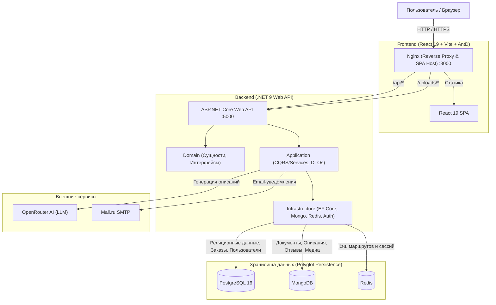

# 🌍 TourismApp — Платформа для поиска, публикации и бронирования туристических маршрутов

[](https://dotnet.microsoft.com/)
[](https://react.dev/)
[](https://www.postgresql.org/)
[](https://www.mongodb.com/)
[](https://redis.io/)
[](https://www.docker.com/)
[](https://vitejs.dev/)
[](https://ant.design/)

**TourismApp** — современный полнофункциональный маркетплейс активного туризма. Платформа объединяет путешественников, гидов-организаторов и администраторов, позволяя находить уникальные туры и активности, формировать составные маршруты, управлять расписанием, бронировать путешествия и генерировать продающие описания с помощью искусственного интеллекта.

---

## 📌 Ключевой функционал

### 🎒 Для туристов (Клиентов)
* **Каталог туров и экскурсий:** умный поиск и фильтрация активностей по категориям, стоимости и параметрам.
* **Детальные карточки активностей:** динамическая галерея фотографий, подробная программа, условия участия и расписание доступных дат.
* **Конструктор составных маршрутов:** возможность компоновать несколько активностей в единый персональный маршрут путешествия (с кэшированием корзины в **Redis**).
* **Бронирование и заказы:** выбор даты, бронирование мест и отслеживание статуса заказа в личном кабинете.
* **Система отзывов и рейтингов:** публикация отзывов с оценками и фотографиями из поездок.

### 🧭 Для гидов и организаторов (Sellers)
* **Публикация активностей:** удобная форма создания туров с загрузкой медиафайлов и настройкой характеристик.
* **Генерация описаний через AI:** встроенная интеграция с нейросетями (**OpenRouter AI**) для автоматического создания ярких продающих описаний туров по ключевым тезисам.
* **Управление расписанием:** добавление дат проведения и ограничений по количеству участников.
* **Дашборд продавца:** трекинг бронирований, заказов клиентов и статусов участников.

### 🛡️ Для администраторов
* **Модерация платформы:** управление опубликованными турами (активация/деактивация).
* **Управление пользователями и контентом:** аудит заказов и поддержание качества контента площадки.

---

## 🏗 Архитектура и технологии

Проект построен на принципах **Clean Architecture** (Чистая архитектура) и концепции **Polyglot Persistence** (полиглотное хранение данных — каждый тип данных хранится в той СУБД, для которой он оптимизирован).



### Стек технологий

| Область | Технологии |
|---|---|
| **Backend** | C#, **.NET 9**, ASP.NET Core Web API, Entity Framework Core 9 |
| **Frontend** | **React 19**, Vite, Ant Design (AntD), Axios, Zustand, React Router v7 |
| **Реляционная БД** | **PostgreSQL 16** (пользователи, роли, расписания, заказы, транзакции) |
| **NoSQL Документы** | **MongoDB** (динамические детали туров `ActivityDetails`, отзывы `Reviews`, галереи) |
| **In-Memory Cache** | **Redis** (хранение активных пользовательских маршрутов `UserRoute`, кэш) |
| **Безопасность** | JWT (JSON Web Tokens), `PasswordHasher` (PBKDF2/HMAC), CORS-политики |
| **Интеграции** | **OpenRouter AI API** (генерация текстов), **SMTP** (email-рассылка) |
| **DevOps & Infra** | **Docker**, Docker Compose, Nginx, многоэтапная сборка (Multi-stage builds) |

---

## 📁 Структура проекта

```plaintext
TourismProject/
├── docker-compose.yml              # Оркестрация всех 6 сервисов
├── init.sql                        # Стартовая схема и дамп PostgreSQL
├── mongo_export/                   # Экспорт коллекций MongoDB (туризм, отзывы, детали)
│   ├── tourism_mongo_db.ActivityDetails.json
│   └── tourism_mongo_db.Reviews.json
│
├── TourismApp/                     # Backend: Решение .NET 9 (Clean Architecture)
│   ├── Dockerfile                  # Многоэтапная сборка API
│   ├── TourismApp.sln
│   ├── API/                        # Презентационный слой (Контроллеры, Program.cs, Middleware)
│   ├── Application/                # Бизнес-логика, Сервисы, DTOs, Валидация
│   ├── Domain/                     # Доменные сущности, Enum, контракты репозиториев
│   └── Infrastructure/             # Реализация репозиториев, EF Core DbContext, Mongo, Redis
│
└── front/                          # Frontend: SPA на React 19 + Vite
    ├── Dockerfile                  # Сборка React и образ Nginx
    ├── nginx.conf                  # Конфигурация проксирования API и раздачи SPA
    ├── package.json
    └── src/
        ├── api/                    # Настройка Axios и перехватчиков токенов
        ├── components/             # Переиспользуемые UI-компоненты
        ├── pages/                  # Страницы приложения (каталог, бронь, админка, заказы)
        └── store/                  # Управление глобальным состоянием (Zustand)
```

---

## 🚀 Быстрый запуск в Docker

Проект полностью контейнеризирован. Для запуска всех компонентов (БД, бэкенд, фронтенд, кэш) требуется только установленный **Docker** и **Docker Compose**.

### 1. Клонирование репозитория
```bash
git clone https://github.com/kjs-git/TourismApp.git
cd TourismApp
```

### 2. Запуск контейнеров
Запустите сборку и старт сервисов одной командой:
```bash
docker compose up -d --build
```

Compose автоматически поднимет:
1. `postgres` — СУБД PostgreSQL на порту `5432` с автоматической инициализацией из `init.sql`.
2. `mongodb` — СУБД MongoDB на порту `27017` с примонтированными данными `mongo_export`.
3. `redis` — Кэш Redis на порту `6379`.
4. `api` — Backend API на порту `5000` (внутри сети на порту `80`).
5. `frontend` — Web-интерфейс на порту `3000`.
6. `localtunnel` — Туннель для демонстрации приложения во внешней сети.

### 3. Точки входа
- **Frontend веб-приложение:** [http://localhost:3000](http://localhost:3000)
- **Backend REST API:** [http://localhost:5000/api](http://localhost:5000/api)
- **PostgreSQL:** `localhost:5432` (База: `tourism_db`, Пользователь: `postgres`, Пароль: `password`)
- **MongoDB:** `mongodb://localhost:27017` (База: `tourism_mongo_db`)
- **Redis:** `localhost:6379`

---

## ⚙️ Локальная разработка (без Docker)

### Backend (.NET 9)
1. Убедитесь, что установлены **.NET 9 SDK**, а также запущены локальные инстансы PostgreSQL, MongoDB и Redis.
2. Перейдите в папку бэкенда:
   ```bash
   cd TourismApp/API
   ```
3. Для локального переопределения секретов (ключи ИИ, почта) скопируйте шаблон:
   ```bash
   cp appsettings.example.json appsettings.Development.json
   ```
4. Запустите API:
   ```bash
   dotnet run
   ```

### Frontend (React 19)
1. Убедитесь, что установлена **Node.js 20+**.
2. Перейдите в папку фронтенда и установите зависимости:
   ```bash
   cd front
   npm install
   ```
3. Запустите сервер разработки:
   ```bash
   npm run dev
   ```
   Приложение откроется на [http://localhost:5173](http://localhost:5173).

---

## 🔒 Безопасность и Best Practices

- **Защита секретов:** Конфигурации для продакшена и шаблоны не содержат чувствительных данных. Локальные пароли и API-ключи хранятся в `appsettings.Development.json`, изолированном в `.gitignore`.
- **Чистота Git:** Исключены артефакты компиляции (`bin/`, `obj/`), кэши IDE (`.vs/`, `.idea/`), временные логи и медиа-загрузки.
- **Структура загрузок:** Директории медиа-файлов защищены `.gitkeep`, сохраняя правильную архитектуру каталогов при чистом репозитории.
